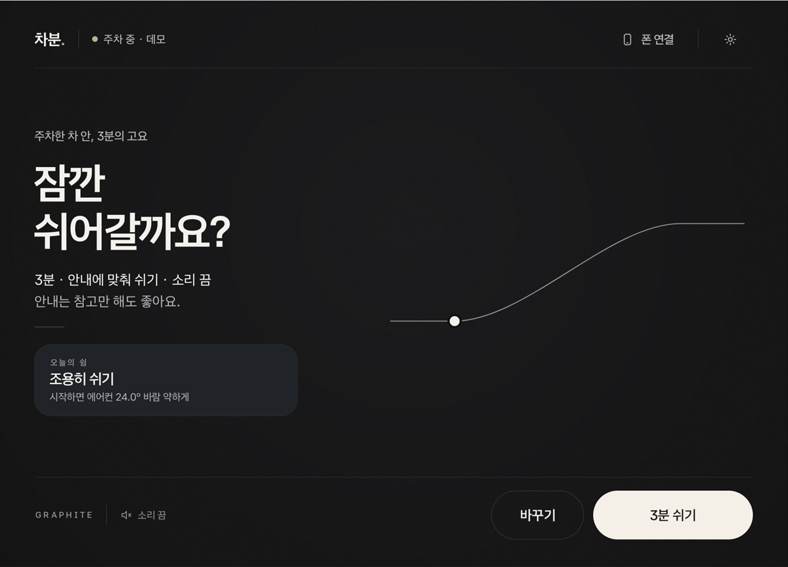

# 차분 (Chabun)

운동을 마치고 주차한 차에 돌아왔을 때, 내가 고른 쉼에 맞춰 에어컨·시트·조명을 맞추고 3분 동안 숨을 고르게 해 주는 Pleos 차량 앱입니다.

이름 '차분'에는 숨이 차분해진다는 뜻과 '차(車) 안의 3분(分)'이라는 뜻을 함께 담았습니다.

| 차 · 시작 화면 | 차 · 3분 쉬기 |
|---|---|
|  |  |

| 폰 · 오늘 | 폰 · 취향 |
|---|---|
|  |  |

## 무엇을 하나
- **3분 쉬기**: 4초 들이쉬기·4초 내쉬기 안내에 맞춰 180초 동안 숨을 고릅니다. 일시정지하면 시간과 그림이 그 자리에서 멈추고, 다시 시작은 직접 누릅니다. 차가 움직이면(기어가 P가 아니거나 속도가 생기면), 다른 화면으로 나가면, 10분 넘게 멈춰 있으면 쉼을 마칩니다.
- **차 안 맞추기와 되돌리기**: 쉼을 시작하면 그 쉼의 에어컨·시트 열선/통풍·앰비언트 조명을 차에 적용하고, 마치면 이 쉼이 바꾼 항목만 쉬기 전 값으로 되돌립니다. 그사이 사람이 손으로 바꾼 값은 그대로 둡니다. 주행 중에는 값을 보내지 않으므로, 차가 움직여 끝난 쉼은 다시 주차하고 차분 화면이 열려 있을 때 되돌립니다. 쉬는 중 앱이 꺼졌다면 다시 열었을 때 되돌립니다. 시트 자세는 움직이지 않습니다.
- **주차 안전 조건**: 기어 P, 속도 0, 차 화면 사용 제한 없음, 통화 중 아님(차의 오디오 상태)을 확인한 뒤에만 시작하고, 차에 값을 보내기 직전마다 기어·속도·화면 제한을 다시 확인합니다.
- **폰에서 고르고 차에서 시작**: 폰에서 고른 쉼과 차 안 설정이 차 시작 화면에 도착합니다. 운동 기록(Health Connect) 연결은 선택이며, 동의하면 운동 종류·시간·마친 시각과 고른 쉼만 전합니다.
- **Gleo 음성**: 조용한 쉼 준비, 차 안 설정 열기, 차 안 맞추기 세 기능을 Gleo App Schema로 작성하고 요청을 받는 쪽을 구현했습니다(`invokeWord` `차분`). 읽기 전용 빌드는 차 안 맞추기를 뺀 두 기능입니다. 쉬기 시작은 화면에서 직접 누를 때만 합니다. 운영사무국 안내(2026-11-13)대로 별도 검토·승인 없이, Pleos 에뮬레이터의 Gleo가 세 기능을 실제로 부르는 것을 확인했습니다. 사람 목소리 대신 한국어 합성 음성을 에뮬레이터 마이크에 넣었고, 실차에서는 아직 확인하지 못했습니다. 호출어와 함께 "차분 앱으로 …"처럼 말해야 이 앱으로 옵니다.
- **하루 쉼과 쉬어 갈 곳**(폰, 모두 기본 꺼짐): 출퇴근 시각 카드와 퇴근 알림, 운동 전 웜업과 운동 뒤 쉼 제안, 숨 돌리는 장소 즐겨찾기, 워치 심박 쉼 제안(선택). 폰에서 보낸 장소는 차 화면에서 주차 상태일 때 '길안내 시작'을 눌러 Pleos NaviHelper로 길안내합니다. 자세한 내용은 아래 '하루 쉼' 절.

## 폴더
| 폴더 | 내용 |
|---|---|
| `vehicle-android/` | 차량 앱. Android Automotive(Pleos), Java |
| `mobile-android/` | 폰 앱. Android, Kotlin |
| `server/` | 폰·차 연결 서버. Node.js, HTTPS |
| `apk/` | 실행 가능한 release APK |
| `docs/screens/` | 화면 캡처(Pleos Emulator, Android 에뮬레이터) |

## APK
| 파일 | 앱 | 앱 이름 | 패키지 |
|---|---|---|---|
| `apk/이동섭_차분_release.apk` | 차량 앱(데모 빌드) | 차분 · Demo | `ai.pitin.vehicle.demo.chabun` |
| `apk/이동섭_차분-읽기전용_release.apk` | 차량 앱(읽기 전용 빌드) | 차분 · Read only | `ai.pitin.vehicle.readonly.chabun` |
| `apk/이동섭_차분-차량제어_release.apk` | 차량 앱(차량 제어 빌드) | 차분 · 차 연결 | `ai.pitin.vehicle.pleos.chabun` |
| `apk/이동섭_차분-폰_release.apk` | 폰 앱 | 차분 | `com.recovery.companion.chabun` |

- 네 APK 모두 디버그가 꺼진 release 빌드이고, 같은 제출용 키로 서명했습니다.
- **가상 차량으로 차 안 맞추기와 되돌리기까지 보려면 데모 APK**를 쓰세요. 앱 안의 가상 차량에 차 안 설정을 맞추고, 가상 차량은 '주차 중'으로 시작합니다. Pleos 에뮬레이터의 실제 값은 바꾸지 않습니다.
- **Pleos 에뮬레이터의 실제 차 상태로 쉬기를 보려면 읽기 전용 APK**를 쓰세요. 기어·속도·화면 제한·통화 상태를 읽어 3분 쉬기를 허용하거나 막습니다. 차 값은 바꾸지 않고 손으로 맞출 값을 안내합니다. 차량 제어 권한(`CONTROL_CAR_*`)이 없습니다.
- **Pleos 에뮬레이터의 공조·시트·조명 값을 실제로 맞추고 되돌리는 것을 보려면 차량 제어 APK**를 쓰세요. `pleos.car.permission.CONTROL_CAR_CLIMATE`·`CONTROL_CAR_SEATS`·`CONTROL_CAR_LIGHTS` 권한을 선언한 빌드입니다. 운영사무국 안내(권한 승인 전에도 소스·시연 영상·APK 제출 가능, 에뮬레이터 개발·시험은 승인 불필요)에 따라 함께 넣었습니다. **Virtual Console을 열어 둔 상태에서** 시험해야 합니다(아래 '실행 방법' 7번).

## 실행 방법
### 차량 앱
1. Pleos Emulator(Android 14, API 34 차량 이미지)를 켭니다.
2. 운전자 사용자 번호를 확인하고 그 사용자에 설치합니다. 시험한 에뮬레이터에서는 10번이었습니다.
   ```
   adb shell am get-current-user
   adb install -r --user 10 apk/이동섭_차분_release.apk
   ```
3. 앱 목록에서 **차분 · Demo**를 엽니다.
4. **3분 쉬기**를 누르면 차 안이 맞춰지고 안내가 시작됩니다. **일시정지**·**마치기**로 멈추거나 끝냅니다.
5. 시작 화면의 **바꾸기**에서 오늘의 쉼, 쉬는 방식, 화면 분위기, 동작 줄이기를 고릅니다(소리는 '끔'만 있고, 잔잔한 소리는 준비 중입니다). 머리말 오른쪽의 **이 차에서 쓸 기능** → **차 안 설정**에서 시트·에어컨·조명 값을 정합니다.
6. 읽기 전용 APK도 같은 방법으로 설치해 **차분 · Read only**를 엽니다. 처음 열 때 속도 읽기 권한을 허용하세요. 안드로이드 권한 창에는 '위치 정보'로 표시되지만, 앱은 위치가 아니라 차 속도만 읽습니다. 허용하기 전 첫 화면은 '지금은 시작할 수 없어요'로 나올 수 있고, 허용한 뒤 에뮬레이터의 기어가 P이고 속도가 0이면 시작할 수 있습니다.
7. 차량 제어 APK(**차분 · 차 연결**)는 Pleos 에뮬레이터의 Virtual Console이 열려 있어야 공조·조명이 응답합니다.
   ```
   adb forward tcp:8088 tcp:8088
   adb install -r --user 10 apk/이동섭_차분-차량제어_release.apk
   ```
   PC 브라우저에서 `http://127.0.0.1:8088/`을 열어 둔 채로 앱을 열고(속도 읽기 권한 허용), **3분 쉬기**를 누릅니다. 처음 설치한 상태에서는 공조 전원·온도·바람이 바뀌고 화면 아래에 '차 안을 맞췄어요'가 보입니다. 시트 통풍과 앰비언트 조명은 **이 차에서 쓸 기능** → **차 안 설정**에서 정해 두면 함께 맞춥니다. **마치기**를 누르면 쉬기 전 값으로 돌아갑니다. 콘솔 페이지를 닫으면 15초쯤 뒤부터 일부 항목이 응답하지 않아 '9개 중 4개'처럼 확인된 것만 셉니다.
8. Gleo 음성으로 시험하려면 세 차량 APK 중 **차량 제어 APK만** 남기고 나머지는 지웁니다. 세 빌드의 호출어(`차분`)가 같아서, 여러 개가 함께 있으면 Gleo가 다른 빌드를 고를 수 있습니다.
   ```
   adb uninstall --user 10 ai.pitin.vehicle.demo.chabun
   adb uninstall --user 10 ai.pitin.vehicle.readonly.chabun
   ```
   에뮬레이터의 Gleo를 열고(예: `adb shell cmd voiceinteraction show`) "차분에서 조용히 쉬고 싶어", "차분 앱에서 시트 설정 열어 줘", "차분 앱으로 지금 차 안을 쉼 설정대로 맞춰 줘"처럼 말합니다. 어느 것으로도 3분 쉬기는 시작되지 않고, 시작은 화면에서 직접 누릅니다. "시트 통풍 2단계로 맞춰 줘"처럼 호출어 없이 말하거나 공조·시트 한 가지만 말하면 Gleo가 자기 차량 기능으로 처리해 이 앱으로 오지 않을 수 있습니다.

### 폰 앱
1. Android 9(API 28) 이상 기기나 에뮬레이터에 설치합니다.
   ```
   adb install -r apk/이동섭_차분-폰_release.apk
   ```
2. **취향**에서 쉼과 차 안 설정을 고릅니다. 운동 기록 연결은 **연결 → 운동 기록**에서 선택합니다.
3. 폰·차 연결(번호와 확인 숫자), **차에 이 쉼 보내기**, 운동 요약 보내기는 연결 서버가 있어야 합니다. 제출 APK는 서버 없이 바로 실행되도록 구성해서 이 기능들은 동작하지 않고, 해당 화면에 그렇다고 표시합니다. 이미 연결된 뒤의 전달 흐름은 시연 영상 0:25~1:23에서 볼 수 있습니다(연결 승인 과정은 영상에 없음). 개발 환경에서는 로컬 HTTPS 서버로 시험했습니다(아래 '연결 서버').

## 테스트 환경
- **개발에 쓴 Pleos Connect 에뮬레이터**: 시스템 이미지 `release_connect_v2.1.0`(Pleos Connect v2.1.0 APIs, Android 14 / API 34, x86_64, `pleos_car_emulator`), Android Emulator 37.2.12
- **화면 규격**: 2560×1440, 160dpi, 가로. 차분이 뜨는 앱 영역은 약 1682×1210이고, 화면은 1680×1200 기준으로 설계해 창 크기에 맞춰 늘리거나 줄입니다.
- 폰: Android 15(API 35) 에뮬레이터, 1080×2400
- 차량 SDK: Pleos Vehicle SDK 2.3.2(`ai.pleos.playground:Vehicle:2.3.2`, Pleos Maven)
- 내비 SDK: Pleos NaviHelper 3.0.5(`ai.pleos.playground:NaviHelper:3.0.5`, pleos·읽기 전용 빌드)
- 개발 PC: Windows 11, JDK 17, Node.js 24
- 실차에서는 아직 확인하지 못했습니다.

## 직접 빌드
JDK 17과 Android SDK가 필요합니다(`ANDROID_HOME` 또는 `local.properties`의 `sdk.dir`). Gradle wrapper가 들어 있습니다.

```
cd vehicle-android
./gradlew :app:assembleDemoDebug                          # 차량 앱 데모(가상 차량)
./gradlew -PincludePleos=true :app:assemblePleosReadOnlyDebug  # 실제 차 상태를 읽기만 하는 빌드(Pleos SDK)
./gradlew -PincludePleos=true :app:assemblePleosDebug     # 실제 차 값을 바꾸는 빌드(Pleos SDK)
./gradlew :app:runVehiclePolicyChecks                     # 차 안 계획·변경 장부·안전 조건 등 순수 Java 검사

cd ../mobile-android
./gradlew :app:assembleDebug                              # 폰 앱
```

- 제출용 서명 빌드는 `-PchabunSigning=<서명 설정 파일>`을 주고 `:app:assembleDemoSubmission`, `-PincludePleos=true :app:assemblePleosReadOnlySubmission`, `-PincludePleos=true :app:assemblePleosSubmission`(차), `:app:assembleSubmission`(폰)으로 만듭니다. 서명 키는 이 저장소에 없습니다.
- `pleos` 빌드는 `pleos.car.permission.CONTROL_CAR_CLIMATE`·`CONTROL_CAR_SEATS`·`CONTROL_CAR_LIGHTS` 권한을 선언합니다. App Market에는 승인된 범위에서만 배포합니다. `pleosReadOnly` 빌드는 이 권한을 선언하지 않습니다.

## 연결 서버
- `server/`는 폰·차 연결 승인, 쉼 취향 공유(`propose_rest`), 운동 요약 전달을 맡습니다. 둘 다 이 컴퓨터(127.0.0.1)에서만 엽니다.
  - 쉼과 차 안 설정 공유: `server/server/preset-sync/index.mjs`. 웹 화면은 `http://127.0.0.1:8792`, 앱은 HTTPS 9447로 붙습니다. 연결 번호는 웹 화면에서 폰용·차량용을 따로 만들고, 웹에서 승인합니다.
  - 운동 요약 전달: `server/server/https.mjs`(9443). 차의 **폰 연결**에서 만든 번호를 폰에 입력하고, 확인 숫자를 맞춘 뒤 차에서 승인합니다.
  - 지금은 이 두 연결이 따로입니다. 출시 단계에서 한 번의 연결로 합칠 계획입니다.
  - 웹 화면은 초기 시제품이라 '집' 귀가 준비 체험(합성 기기)이 남아 있습니다. 차분의 제출 범위에는 들어가지 않습니다.
- 제출 APK는 연결 서버를 쓰지 않습니다. 코드에 남은 기본 주소는 에뮬레이터용 로컬 주소(10.0.2.2, 127.0.0.1)뿐이고, 믿을 인증서도 들어 있지 않습니다. 연결 화면에는 '이 빌드는 연결 서버 없이 동작해서 … 쓸 수 없어요'라고 표시합니다.
- 직접 켜 보려면(선택, Node.js 20 이상):
  ```
  cd server
  npm run dev-tls          # 개발용 인증서를 server/.dev-tls/에 만듭니다. 개인 키는 git에 들어가지 않습니다.
  ```
  출력된 PowerShell 두 줄로 인증서 경로를 정한 뒤 `npm run start:preset-sync`(8792·9447)와 `npm run start:https`(9443)를 켭니다. 인증서 경로가 없으면 서버가 무엇을 정해야 하는지 알려 주고 멈춥니다.
  앱이 이 인증서를 믿게 하려면 디버그 빌드를 `-PlocalTlsCa=<dev-cert.pem의 절대 경로>`로 만듭니다(차 `:app:assembleDemoLocalTlsDebug`, 폰 `:app:assembleLocalTlsDebug`). 폰 에뮬레이터는 `adb reverse tcp:9443 tcp:9443`, `adb reverse tcp:9447 tcp:9447`로 이 PC에 닿습니다.
  2026-11-06에는 두 서버가 이 인증서로 뜨고 TLS 검증을 통과하는 것까지 확인했습니다. 2026-11-14에는 `-PlocalTlsCa`로 만든 폰·차 디버그 빌드를 이 방식으로 서버에 연결해 하루 쉼 흐름을 확인했습니다(아래 '하루 쉼' 절).
- 서버 검사:
  ```
  cd server
  npm test
  ```
  2026-11-14에 109개 모두 통과했습니다(약 40초). 컴퓨터 부하가 크면 시간 초과로 일부가 실패할 수 있습니다.

## 검증한 것과 아직 못 한 것
- **확인함**(에뮬레이터): 폰 → 서버 → 차로 쉼과 차 안 설정이 도착합니다.
- **확인함**(Pleos 에뮬레이터 + Virtual Console, 2026-11-04~11): `pleos` 빌드로 공조 전원·온도·바람, 운전석 시트 통풍 2단계, 앰비언트 조명 켜기·밝기·색을 적용하고 다시 읽어 모두 확인했습니다. 마치면 최근 것부터 쉬기 전 값으로 되돌려 다시 읽어 확인했습니다.
- **확인함**(같은 환경, 2026-11-06): 쉬는 중 기어를 D로 바꾸면 쉼을 마치고 주행 중에는 값을 보내지 않으며, P로 돌아오면 바꾼 6개 항목을 되돌려 모두 확인했습니다. 쉬는 중 다른 화면으로 나가면 그 자리에서 되돌립니다. 읽기 전용 빌드도 D에서 쉼을 마칩니다.
- **확인함**(같은 환경, 2026-11-11): 쉬는 중 앱을 강제로 끄고 다시 열면 바꾼 6개 항목을 되돌려 모두 확인했습니다. 앱이 뒤에 있다가 차 안 맞추기 요청(Gleo와 같은 Intent)으로 앞에 올 때도 주차 상태를 새로 읽어 적용합니다.
- **확인함**(에뮬레이터, 2026-11-04): 읽기 전용 빌드에서 실제 차 상태로 3분 쉬기(시작·일시정지·계속·마치기). 합성 운동 기록의 운동 요약 전달(폰 '차로 보내기' → 차 '운동 기록이 도착했어요 · 동승자 보호로 숨김').
- **확인함**(Pleos 에뮬레이터 + Virtual Console, 2026-11-13~14): Gleo(`ai.umos.ambientai` 4.2.0.15)가 한국어 합성 음성을 알아듣고 세 기능(쉼 준비, 차 안 설정 열기, 차 안 맞추기)을 불렀고, 앱의 응답을 받아 말로 답했습니다. 제출용 차량 제어 APK로 앱이 꺼진 상태에서도 세 기능을 확인했습니다(Gleo 요청부터 앱 응답까지 0.7~2.3초). 차 안 맞추기는 에뮬레이터의 공조 값을 실제로 바꿨고, adb로 직접 보낸 차 안 맞추기 요청은 제출 APK가 거절합니다.
- **확인함**(자동 검사): 차량 앱 순수 Java 검사 항목 867개(2026-11-14; 차 안 계획 132개, 변경 장부 38개, 쉼 중단 24개, 설정 53개, Gleo 차 안 기능 113개, Gleo 요청 경계 47개, 쉬어 갈 곳 27개 등), 폰 순수 Kotlin 검사 303개, 서버 시험 109개(2026-11-14).
- **주의**: Virtual Console 페이지를 열어 두지 않으면 에뮬레이터의 공조 등 일부 항목이 응답하지 않습니다. 이때 앱은 다시 읽어 확인된 것만 '맞췄어요'로 셉니다(예: '차 안 9개 중 4개를 맞췄어요'). 시연 영상은 콘솔을 연결한 상태에서 녹화했습니다.
- **아직 못 함**:
  - 실차 확인.
  - 실차와 사람 목소리로 하는 Gleo 호출. 에뮬레이터에서 합성 음성으로만 확인했습니다. 공식 호출자 확인 방법은 공개 문서에 없어, 차 안 맞추기는 에뮬레이터에서 본 Gleo 앱이 보낸 요청만 받습니다(adb로는 쉼 준비와 차 안 설정 열기만 됩니다). 안내가 나오면 그에 맞춥니다.
  - 통화로 쉼이 멈추는 것은 데모 빌드의 합성 신호로만 확인했습니다.
  - 되돌리기 기록에는 유효 기간이 없습니다. 쉬는 중 전원이 꺼진 뒤 오래 지나 앱을 열어도, 값이 그대로면 쉬기 전 값으로 되돌립니다. 실차 단계에서 기간을 정할 계획입니다.

## 개인정보와 안전
- 차분은 피로나 회복 상태를 판정하지 않고, 의료적 효과를 주장하지 않습니다.
- 운동 기록은 폰에 둡니다. 사용자가 동의한 경우에만 운동 종류·시간(분)·마친 시각과 고른 쉼을 차에 전하고, 심박 원본과 위치는 보내지 않습니다.
- 차 값은 주차 조건이 맞을 때만 바꾸고, SDK의 '성공' 응답이 아니라 다시 읽은 값으로 결과를 판단합니다.

## 하루 쉼

> 2026-11-15 제출본에 들어 있다. 제출용 APK는 연결 서버 없이 동작하므로 장소 찾기와 차로 보내기는 개발용 빌드(연결 서버)에서 쓴다.

운동 뒤 차에서 3분 쉬던 흐름을 하루의 틈(출근 전, 퇴근길, 운동 전후, 심박이 높게 이어질 때)으로 넓힌다. 앱은 쉼을 **제안만** 한다. 쉬기 시작과 길안내 시작은 언제나 사용자가 직접 누른다. 모든 기능은 기본으로 꺼져 있고, 위치 권한은 요청하지 않는다.

### 기능

| 기능 | 어디서 | 무엇을 읽고 보내나 | 확인 |
|---|---|---|---|
| 출퇴근 쉼 카드 | 폰 · 연결 › 하루 쉼 › 출퇴근, 홈 '지금' 카드 | 폰 시계만 읽는다. 보내는 것 없음. '오늘은 닫기'는 그 창이 속한 날로 기록 | 폰 에뮬레이터 |
| 오늘 운동 → 웜업 → 운동 뒤 쉼 | 폰 · 하루 쉼 › 오늘 운동, 웜업 화면 | 계획은 폰에만. 운동 읽기를 허용했으면 앱을 열 때 계획 무렵 끝난 운동의 끝 시각 하나만 읽는다 | 폰 에뮬레이터 |
| 쉬어 갈 곳 | 폰 · 하루 쉼 › 쉬어 갈 곳 | 이름·주소·좌표·종류를 폰에만. 자주 가는 곳은 '여기 왔어요'·'차로 보내기' 횟수로만 센다(GPS 없음) | 폰 에뮬레이터 |
| 장소 찾기(카카오) | 쉬어 갈 곳 › 장소 찾기('취향 함께 쓰기' 연결 필요) | 폰 → 서버: 검색어와 종류만. 서버가 카카오 REST 키로 대신 찾는다 | 서버 시험(가짜 응답). **실제 카카오 호출은 키가 없어 못 함** |
| 차로 보내기 · 차 길안내 | 폰 장소 › 차로 보내기 → 차 '함께 쓰는 쉼'의 '폰에서 보낸 쉬어 갈 곳' 카드 | 장소 1건의 이름·주소·좌표만. 차는 주차·정지 상태에서 누를 때만 NaviHelper로 길안내(좌표 없으면 내비 이름 검색) | **에뮬레이터 두 대로 폰→서버→차→내비 전체 흐름 확인**, Pleos 계측 시험 |
| 퇴근 알림 | 하루 쉼 › 출퇴근 › 퇴근 무렵 알림 | 다음 켜진 요일의 퇴근 15분 전 알림 1건(`setAndAllowWhileIdle`, 정확한 알람 권한 없음) | 에뮬레이터에서 알림 표시·다음 요일 재예약 |
| 심박 쉼 제안 | 하루 쉼 › 워치 신호, 홈 '지금' 카드 | 앱을 열 때 최근 7일 심박과 운동 시간을 읽어 폰 안에서 계산하고 버린다. 보내는 것 없음 | 디버그 전용 합성 심박으로 카드 확인. 실제 워치는 미확인 |

### 실행 방법

- 서버: `npm run dev-tls` 뒤 `KAKAO_REST_KEY`(developers.kakao.com에서 발급한 REST API 키)를 환경변수로 두고 `npm run start:preset-sync`. 키가 없으면 장소 찾기는 `503 PLACES_UNAVAILABLE`, 직접 입력한 곳의 차로 보내기는 키 없이 된다. 검색은 연결당 1분 30번, 서버 전체 1분 120번.
- 폰: `-PlocalTlsCa=<개발 CA pem>`으로 `:app:assembleLocalTlsDebug`, `adb reverse tcp:9447 tcp:9447`, 연결 › 취향 함께 쓰기로 공유 서버에 잇는다(번호는 `http://127.0.0.1:8792`에서 만들고 승인).
- 차: `-PincludePleos=true -PlocalTlsCa=<개발 CA pem>`으로 `:app:assemblePleosLocalTlsDebug`, 폰 연결 › 함께 쓰는 쉼 목록에서 차량용 번호로 잇는다. Pleos 에뮬레이터에서는 Virtual Console(8088)을 이어 둬야 기어가 읽혀 '주차·정지' 확인이 된다.
- 검사: 폰 `:app:runChabunDayChecks`, 차 `:app:runVehiclePolicyChecks`(RestPlace 포함), 서버 `npm test`. 내비 계측 시험은 `-PplaceNavAcceptance=true`로 androidTest를 만든 뒤 `am instrument -w ai.pitin.vehicle.pleos.test/ai.pitin.vehicle.PlaceNavigationInstrumentation`.

### 확인한 것

- 폰(API 35 에뮬레이터): 출퇴근 카드와 '오늘은 닫기', 운동 계획 → 웜업 → 운동 뒤 쉼, 쉬어 갈 곳, 퇴근 알림 표시, 합성 심박 1018개로 심박 카드.
- 폰 → 서버 → 차 → 내비: 폰 '차로 보내기' → 서버 공유 상태에 이름·주소·좌표만 저장(방문 횟수 없음) → 차 카드 표시 → P 상태에서 '내비에서 찾기'로 내비 검색. 기어를 모를 때는 '주차하고 멈춘 뒤에…' 안내로 막힌다.
- 좌표가 있는 장소: 폰과 같은 요청(propose_place)을 시험 도구로 보내 차 카드 → '길안내 시작' → 서울시청 실제 길안내(22km)까지 확인. 길안내가 시작되면 다음에 '함께 쓰는 쉼'을 열 때 카드가 지워진다.
- Pleos 에뮬레이터 계측 시험: 서울시청 좌표로 실제 길안내 시작, 서울숲은 이름 검색 화면. 에뮬레이터 내비는 약 7초 뒤 `onRouteStarted`로 답한다(문서의 `onRoutingCompleted`는 오지 않음).
- NaviHelper 3.0.5 AAR 바이트코드: `RouteInfo`는 위도가 먼저다(문서의 Java 예제는 경도가 먼저라 틀림).
- 자동 검사: 폰 `ChabunDayChecks` 144개와 기존 폰 검사, 차 정책 검사(`RestPlaceTest` 27개 포함), 서버 109개.
- 검토: Gemini Hydrogen·Carbon, Claude Opus 5.5(agy) 세 번의 독립 검토를 반영했다.

### 아직 못 한 것과 제한

- 실제 카카오 호출, 카카오 무료 한도·결과 저장 약관 확인(배포 전 필수).
- 실제 워치·실제 운동 기록·실차 확인. 워치가 심박을 드물게 기록하거나 늦게 동기화하면 심박 제안은 거의 뜨지 않을 수 있다.
- 서버의 장소 1건은 메모리에만 있고 새로 보내거나 서버를 다시 켜면 사라진다. 로컬 웹 화면에는 이름·위치를 보여 주지 않는다.
- GPS 주변 찾기는 넣지 않았다. 우리 서버가 좌표를 받으면 위치정보법상 위치기반서비스 신고가 필요할 수 있어, 확인한 뒤 정한다.

### 개인정보

- 이 폰에만: 출퇴근 설정, 운동 계획 1건(다음 날 0시와 계획 + 3시간 중 늦은 때 지움), 장소 책(최대 50곳, 90일 넘게 안 쓴 비즐겨찾기는 지움), 심박 제안의 켜짐 여부·마지막 제안 시각·닫은 날짜. 클라우드 백업과 기기 간 이전에서 빠진다.
- 서버로: 장소 찾기의 검색어·종류, 차로 보내기의 장소 1건(이름·주소·좌표). 서버는 검색어·키를 로그에 남기지 않는다.
- 보내지 않음: GPS·현재 위치, 심박 원본과 계산 결과, 방문 횟수·날짜·즐겨찾기 여부, 출퇴근 시각, 운동 계획.
- Health Connect: 운동 읽기는 누를 때, 그리고 운동 계획·심박 제안을 켠 동안 앱을 열 때 운동 시간을 읽는다. 심박 읽기는 심박 제안을 켤 때 묻고(운동 읽기도 함께 필요), 앱을 열 때만 읽는다. 디버그 빌드만 시험용 `WRITE_HEART_RATE`를 선언한다.
- 심박 숫자를 보여 주지 않고, 피로·스트레스·건강 상태를 판정하지 않는다. 의료기기가 아니다.

## 시연 영상
접수 메일에 붙인 `차분_시연영상_2026-11-14.mp4`(3분)가 무엇을 담고 무엇을 담지 않았는지 적습니다.
- 11월 13~14일 빌드를 녹화했습니다. 그 뒤 추가한 **하루 쉼·쉬어 갈 곳·NaviHelper 길안내와 마지막 검토 반영분은 영상에 없습니다**. 확인 결과는 아래 '하루 쉼' 절에 있습니다.
- 0:00~2:39는 연결 서버에 붙는 개발용 빌드(같은 소스에 개발용 서버 인증서만 넣은 차 pleos·데모 빌드와 폰 빌드)로 녹화했습니다. 그래서 2:27에 데모 빌드의 개발자 설정(디버그 서버 주소 칸)이 보이고, 0:51 폰 화면에는 초기 시제품의 공유 쉼 데이터에 남은 '집 …' 항목이 작게 보입니다. 제출 APK에는 디버그 칸이 없습니다.
- 2:39~2:51 Gleo 장면은 제출용 차량 제어 release APK로 녹화했습니다. 앱이 열린 상태에서 '차 안 맞추기' 1개 기능을 부른 장면이고, 말소리는 녹음하지 않아 자막으로 보여 줍니다(세 기능과 앱이 꺼진 상태의 호출은 '검증한 것' 절).
- 차 화면의 공조 표시는 운전석 쪽만 바뀝니다. 시트·조명은 Pleos 에뮬레이터 화면에 따로 보이지 않아 앱의 확인 문구로 확인합니다. 2:22의 '차 안 7개'는 11월 13일 녹화 때 바꾼 항목 수입니다(11월 6일 기어 시험은 6개).
- 배경 음악은 Google Cloud Vertex AI Lyria 2로 만들어 영상에만 넣었습니다. 앱은 소리를 내지 않습니다.

## 그림·영상·글꼴 출처
- 쉼 화면(Pearl·Umber)의 그림 영상과 `server/`의 사용 안내 페이지·참고 폴더에 있는 그림·영상은 생성형 AI 도구로 만든 것을 바탕으로 했습니다(일부 파일에 C2PA 출처 표시가 들어 있습니다). 글자·타이머·버튼과 움직임은 앱 코드가 그립니다. 다른 사람의 저작물은 넣지 않았습니다.
- 시연 영상의 배경 음악은 Google Cloud Vertex AI Lyria 2로 만들었습니다.
- 서버 웹 화면의 글꼴 Noto Sans KR은 SIL Open Font License 1.1입니다(`server/web/fonts/OFL.txt`).

## 세부 문서
- `vehicle-android/README.md`, `mobile-android/README.md`: 개발 기록(시점별 변경). 최신 설명은 이 README입니다.
- `vehicle-android/GLEO_INTEGRATION.md`: Gleo 연동 기록.
